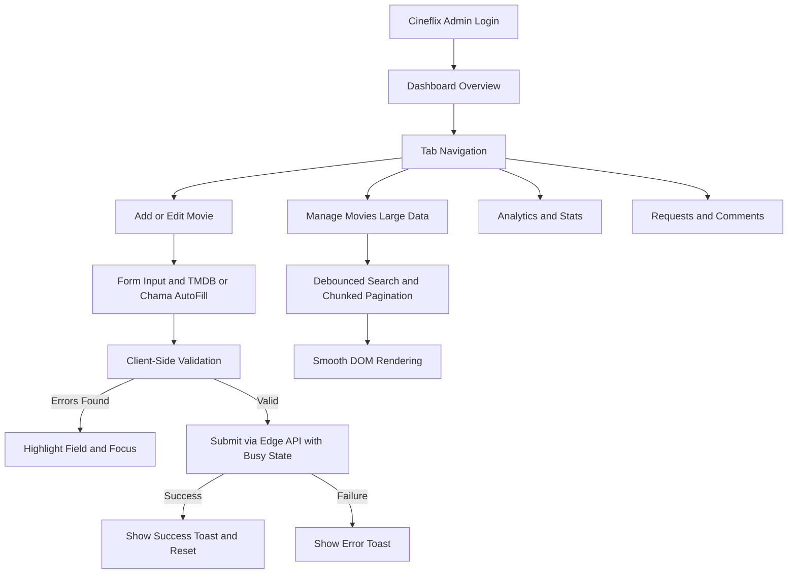

# Admin Panel Redesign and Optimization Plan

## Overview
This plan outlines the comprehensive redesign and performance optimization of the **MovieMania LK Admin Panel** (`admin/index.html`). The goal is to deliver an intuitive, responsive, robust, and high-performance administrative interface with bulletproof form validation, smooth data handling, comprehensive error notifications, and consistent **MovieMania LK** branding.

---

## Architecture & Improvements

### 1. UI/UX & Layout Redesign
- **Branding Update**: Ensure all title, header, and login branding references **Cineflix Admin Panel** consistently.
- **Design System Integration**: Consistent use of CSS variables (`--bg`, `--bg2`, `--bg3`, `--bg4`, `--red`, `--text`, `--text2`, `--text3`, `--focus`, `--err`, `--ok`), clean spacing, and modern card components.
- **Responsive Grid System**: Fluid multi-column layouts for desktop that gracefully collapse to single-column views on mobile devices.
- **Sticky Navigation & Save Bar**: Sticky header tabs and bottom save action bar with safe-area inset support for mobile screens.

### 2. Form Validation, Submission & Bug Fixes
- **Strict Validation Rules**: Validate required fields (Title, Year, Quality, Type) and numeric constraints (Rating 0-10, Runtime, Year range).
- **Error Feedback**: Inline `.fld-err` messages, `.invalid` border highlights, and automatic focus/scroll jump to the first erroneous field.
- **Double-Submission Prevention**: Disabling buttons and adding `.busy` spinner states during active network requests.
- **Unsaved Changes Guard**: `beforeunload` event listener prompting users if they attempt to close the tab with unsaved form input.

### 3. Data Performance & Large Volume Handling
- **Pagination / Virtualized Chunking**: Implement efficient chunked loading and pagination for the movie management list (`loadMovies` / filter / search) to prevent DOM lag when displaying thousands of items.
- **Debounced Search & Filtering**: Instantaneous debounced filtering for large movie inventories, comments, requests, and reports.
- **Optimized DOM Updates**: DocumentFragment batching and efficient template literals.

### 4. Error Handling & Notifications
- **Toast Notification Engine**: Universal `showToast(msg, type)` supporting success (`#22c55e`), error (`#f87171`), and warning (`#f5c518`) statuses.
- **API Error Recovery**: Catch blocks on all fetch calls to `/api/admin/db` and external endpoints with detailed error messages and graceful fallbacks.

---

## Workflow Diagram

---

## Implementation Steps

1. **Refine Branding & Layout Styles**: Update title, headers, and UI elements to **Cineflix** branding along with mobile responsiveness and spacing.
2. **Upgrade Form Validation & State Management**: Implement rigorous client-side checks, focus management, double-submit protection, and unsaved changes confirmation.
3. **Optimize Data Management & Rendering**: Add pagination and optimized search/filtering for managing large volumes of movies and records without lag.
4. **Enhance Error Handling & Toast Notifications**: Build a versatile toast notification system and comprehensive try/catch recovery across all admin actions.
5. **Testing & Verification**: Verify forms, responsiveness, and performance.
